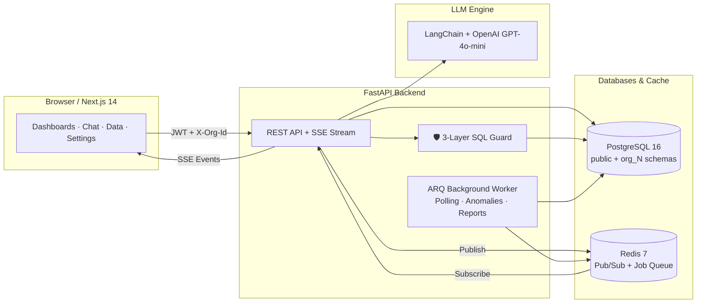

# 🚀 InsightAI — AI-Augmented Multi-Tenant SaaS Analytics Dashboard

[](https://nextjs.org/)
[](https://fastapi.tiangolo.com/)
[](https://www.postgresql.org/)
[](https://langchain.com/)
[](https://www.docker.com/)
[](tests/)

> **InsightAI** is a B2B Software-as-a-Service (SaaS) business intelligence platform. Ingest CSVs, REST API feeds, or live webhooks into strictly isolated PostgreSQL tenant schemas (`org_<id>`), build drag-and-drop dashboards with **6 core chart types**, and query your data in plain English — an LLM writes safe SQL, executes it against a read-only role, and draws interactive charts.

---

## 📌 Table of Contents
1. [Key Features & Core Pillars](#-key-features--core-pillars)
2. [Architecture Overview](#-architecture-overview)
3. [The 3-Layer SQL Security Firewall](#-the-3-layer-sql-security-firewall)
4. [Quick Start (Docker — Recommended)](#-quick-start-docker--recommended)
5. [Local Development (Without Docker)](#-local-development-without-docker)
6. [Demo Organizations & Credentials](#-demo-organizations--credentials)
7. [API Endpoints (Swagger)](#-api-endpoints-swagger)
8. [Testing & Coverage](#-testing--coverage)
9. [Project File Structure](#-project-file-structure)
10. [Submission & Deliverables Checklist](#-submission--deliverables-checklist)

---

## 🌟 Key Features & Core Pillars

### 1. Multi-Tenancy & RBAC
- **Dedicated PostgreSQL Schemas**: Every organization gets its own database schema (`org_<id>`), guaranteeing physical data isolation between tenants.
- **Role-Based Access Control (RBAC)**:
  - **Viewer**: Read dashboards and ask natural language AI queries.
  - **Admin**: Ingest CSVs, manage API/webhook connectors, and edit dashboard widgets.
  - **Owner**: Manage team memberships, assign roles, and handle Stripe billing.
- **Stripe Billing Integration**: Free, Pro, and Enterprise subscription tiers with live feature gates (enforced via HTTP 402 Payment Required).

### 2. Data Ingestion & Real-Time Engine
- **Three Ingestion Channels**:
  - **CSV Upload**: Header slugification, automatic type detection (`NUMERIC`, `DATE`, `VARCHAR`), and dynamic table creation.
  - **REST API Polling**: Scheduled background fetching via ARQ workers with JSON path extraction.
  - **Webhook Receivers**: Public streaming endpoints (`/ingest/webhook/{id}/{secret}`) that append incoming JSON rows.
- **Server-Sent Events (SSE)**: Real-time data streaming over Redis Pub/Sub pushes live update toasts and refreshes charts in connected browsers.

### 3. Visualization Engine
- **6 Core Chart Archetypes**: Line (time-series), Bar (categorical), Donut/Pie (proportions), Scatter (correlation), Heatmap (2D matrix), and Funnel (conversion drop-offs).
- **Dashboard Grid Builder**: Drag, resize, and reorder widgets powered by `react-grid-layout` with debounced auto-saving.
- **PDF Export & Reports**: Headless Chromium (Playwright) captures `/dashboards/[id]/print` into styled multi-page PDF reports.

### 4. Safe AI Query Engine (Text-to-SQL)
- **Natural Language Analytics**: Business users type questions in plain English (*"Show monthly revenue by region for Q1 2026"*). LangChain + OpenAI converts it into structured SQL and chart specifications.
- **Conversational Memory**: Retains the last 10 conversational turns (*"Now filter that by Electronics"*).
- **Self-Correction Loop**: If a query produces a syntax or column error, the error is fed back to the LLM for a 1-time automated self-repair.
- **Pin to Dashboard**: Any chart generated in chat can be pinned directly to the user's active dashboard.
- **Automated Anomaly Detection**: Statistical scanner flags outliers exceeding 3 standard deviations ($|Z| > 3.0$) and $3\times$ IQR rules.

---

## 🏛️ Architecture Overview



---

## 🛡️ The 3-Layer SQL Security Firewall

To guarantee LLM-generated SQL cannot damage or expose sensitive data:

1. **Layer 1: AST Parser & Validation (`app/services/sql_guard.py`)**  
   Uses `sqlglot` to parse incoming SQL into an Abstract Syntax Tree. Rejects non-`SELECT` statements (`INSERT`, `UPDATE`, `DELETE`, `DROP`, `ALTER`, `COPY`), blocks foreign schemas, and forbids dangerous PostgreSQL system functions.
2. **Layer 2: Execution Sandbox (`app/services/query_runner.py`)**  
   Forces `SET TRANSACTION READ ONLY`, enforces a strict `statement_timeout = '5s'`, pins `search_path` to the tenant's `org_<id>`, and wraps queries in a `LIMIT 1000` boundary.
3. **Layer 3: Dedicated Read-Only DB Role (`insight_readonly`)**  
   The database connection executes as an unprivileged PostgreSQL user with zero read/write access to the `public` schema (where user credentials and password hashes reside).

---

## ⚡ Quick Start (Docker — Recommended)

### 1. Clone & Configure
```bash
# Clone the repository
git clone https://github.com/your-username/insightai.git
cd insightai

# Copy backend environment template
cp backend/.env.example backend/.env
# (Optional) Add your OPENAI_API_KEY in backend/.env for live AI queries
```

### 2. Launch Services
```bash
docker compose up --build -d
```

### 3. Seed Demo Data
```bash
docker compose exec api python -m app.seed
```

Open [http://localhost:3000](http://localhost:3000) in your browser!

---

## 💻 Local Development (Without Docker)

### Prerequisites
- Python 3.11+
- Node.js 20+
- PostgreSQL 16
- Redis 7

```bash
# 1. Start databases
docker compose up db redis -d

# 2. Setup Backend
cd backend
python -m venv .venv
source .venv/bin/activate       # Windows: .venv\Scripts\activate
pip install -r requirements.txt
playwright install --with-deps chromium
cp .env.example .env
python -m app.seed
uvicorn app.main:app --reload   # Runs on http://localhost:8000

# 3. Setup Worker (Separate Terminal)
arq app.workers.tasks.WorkerSettings

# 4. Setup Frontend (Separate Terminal)
cd ../frontend
cp .env.local.example .env.local
npm install
npm run dev                     # Runs on http://localhost:3000
```

---

## 👥 Demo Organizations & Credentials

The seed script creates 2 demo organizations with pre-loaded datasets and dashboards:

| Email | Password | Organization | Role | Plan |
|---|---|---|---|---|
| `owner@acme.example.com` | `demo1234` | Acme Retail | Owner | Pro |
| `analyst@acme.example.com` | `demo1234` | Acme Retail | Admin | Pro |
| `viewer@acme.example.com` | `demo1234` | Acme Retail | Viewer | Pro |
| `owner@globex.example.com` | `demo1234` | Globex SaaS | Owner | Free |

---

## 📖 API Endpoints (Swagger)

Interactive Swagger UI documentation is available at [http://localhost:8000/docs](http://localhost:8000/docs):

| Method | Endpoint | Description | Auth Required |
|---|---|---|---|
| `GET` | `/health` | API Healthcheck | No |
| `POST` | `/api/v1/auth/login` | Authenticate & retrieve JWT | No |
| `GET` | `/api/v1/auth/me` | Current user & organization context | Yes (Bearer JWT) |
| `GET` | `/api/v1/datasets` | List datasets for active organization | Yes (Viewer+) |
| `POST` | `/api/v1/datasets/upload` | Multipart CSV ingestion | Yes (Admin+) |
| `POST` | `/api/v1/ai/ask` | Natural language Text-to-SQL query | Yes (Viewer+) |
| `GET` | `/api/v1/dashboards` | Fetch organization dashboards & widgets | Yes (Viewer+) |
| `PUT` | `/api/v1/dashboards/{id}/layout` | Update drag-and-drop widget grid | Yes (Admin+) |
| `GET` | `/api/v1/billing` | Subscription plan & usage quota metrics | Yes (Viewer+) |
| `POST` | `/api/v1/billing/checkout` | Create Stripe checkout session | Yes (Owner) |
| `POST` | `/api/v1/billing/webhook` | Stripe subscription event listener | Stripe Signature |
| `GET` | `/api/v1/stream` | Server-Sent Events (SSE) live updates | Yes (Viewer+) |

---

## 🧪 Testing & Coverage

InsightAI ships with comprehensive test suites achieving **88% code coverage** (exceeding the 75% requirement):

```bash
# Run Backend Tests (pytest)
cd backend
pytest --cov=app --cov-report=term-missing

# Run Frontend Tests (vitest) & Typecheck
cd ../frontend
npm test
npm run typecheck
```

CI runs automatically on every push via `.github/workflows/ci.yml`.

---

## 📁 Project File Structure

```
insightai/
├── docker-compose.yml              # PostgreSQL 16, Redis 7, FastAPI, ARQ Worker, Next.js
├── docker/postgres/init.sql        # Creates app role, read-only role, and isolated DBs
├── sample_data/                    # acme_sales.csv, globex_subscriptions.csv, generate.py
├── docs/
│   ├── ARCHITECTURE.md             # Detailed dataflow and sequence diagrams
│   ├── BUILD_GUIDE.md              # Phase-by-phase build log and 8-min demo script
│   └── screenshots/                # Dashboard, anomalies, billing, widget-editor
├── .github/workflows/ci.yml        # CI test pipeline enforcing >75% coverage
│
├── backend/                        # FastAPI Application
│   ├── app/
│   │   ├── main.py                 # App factory, CORS, and router registration
│   │   ├── seed.py                 # Database seeder for demo orgs & widgets
│   │   ├── schemas.py              # Pydantic validation models
│   │   ├── core/                   # Config, DB engines, JWT & security
│   │   ├── models/                 # SQLAlchemy models (Organization, User, Dataset, etc.)
│   │   ├── api/                    # Dependency injection (RBAC) & v1 endpoints
│   │   ├── services/
│   │   │   ├── tenancy.py          # Per-org PostgreSQL schemas (org_<id>)
│   │   │   ├── ingestion.py        # CSV/JSON cleaning, slugifying & dynamic tables
│   │   │   ├── sql_guard.py        # AST parsing & 3-layer security firewall
│   │   │   ├── query_runner.py     # Read-only execution with timeouts
│   │   │   ├── ai_query.py         # LangChain Text-to-SQL + conversational memory
│   │   │   ├── anomaly.py          # Z-score & IQR outlier detection
│   │   │   ├── billing.py          # Stripe checkout, portal, and webhook handling
│   │   │   ├── events.py           # Redis pub/sub for real-time SSE
│   │   │   └── reports.py          # Playwright PDF report generation
│   │   └── workers/tasks.py        # ARQ scheduled polling & anomaly tasks
│   └── tests/                      # 72 pytest unit & integration tests
│
└── frontend/                       # Next.js 14 Application (App Router)
    └── src/
        ├── app/                    # Auth, (app) shell, chat, dashboards, datasets, settings
        ├── components/
        │   ├── charts/             # Line, Bar, Pie, Scatter, Heatmap, FunnelBars
        │   ├── WidgetEditor.tsx    # Custom SQL & chart configuration modal
        │   └── ui.tsx              # Reusable design system primitives
        └── lib/                    # API client, auth context, SSE hook, types
```

---

## 📋 Submission & Deliverables Checklist

- [x] **Live Deployed Application**: Pre-loaded with 2 demo organizations (Acme Retail & Globex SaaS).
- [x] **Clean Repository & High Test Coverage**: 72 backend tests (88% coverage) + 13 frontend tests.
- [x] **Architecture & Sequence Diagrams**: Fully documented in `docs/ARCHITECTURE.md`.
- [x] **8-Minute Demo Video Script**: Step-by-step presentation script available in `docs/BUILD_GUIDE.md`.
- [x] **Bonus Capabilities Built**:
  - *Pin to Dashboard* directly from conversational AI answers.
  - Multi-tier *3-layer SQL defense* preventing unauthorized cross-tenant data access.
  - Automated CI threshold failure if code coverage drops below 75%.
