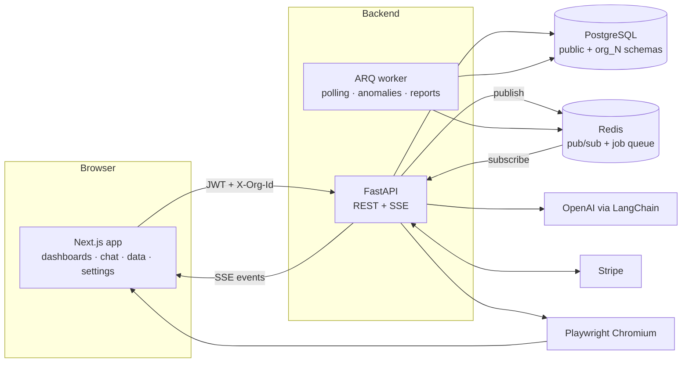
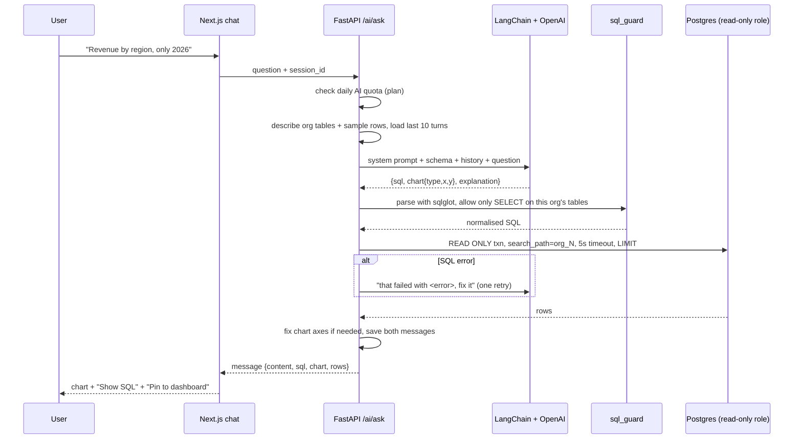
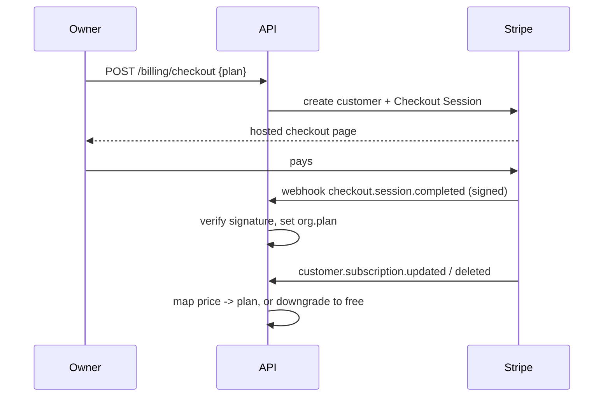

# Architecture

## System overview



## Multi-tenancy model

```
public schema (app data)                  org_1 schema (Acme's data)     org_2 schema (Globex's data)
├── organizations  (plan, stripe ids)     ├── acme_sales                 ├── subscriptions
├── users          (bcrypt hashes)        └── acme_marketing             └── ...
├── memberships    (user, org, role)
├── datasets       (org_id, table_name, columns)
├── dashboards / widgets / report_schedules
├── chat_sessions / chat_messages
├── connectors / anomalies / usage_counters
```

Every request carries `Authorization: Bearer <jwt>` and `X-Org-Id`. `require_role()` (in `api/deps.py`)
checks membership and role, and every query filters by `ctx.org.id`. A user who is not a member gets
404, so org ids can't be probed.

Roles: **Viewer** reads dashboards and asks AI questions · **Admin** also uploads data, edits
dashboards, manages connectors and members · **Owner** also changes roles and billing.

## AI query flow (Text-to-SQL)



### Three layers of SQL safety

1. **Validation** (`sql_guard.py`): one statement; SELECT/UNION/CTE only; no INSERT/UPDATE/DELETE/DDL/
   `SELECT INTO`/`SET`/`COPY` anywhere in the tree; every table must be one of the org's datasets;
   other schemas (`org_2`, `pg_catalog`, `information_schema`) rejected; `pg_*`, `dblink`, `lo_*`,
   `current_setting` functions blocked.
2. **Execution** (`query_runner.py`): `SET TRANSACTION READ ONLY`, `search_path` pinned to the tenant
   schema, `statement_timeout`, wrapped with a row `LIMIT`.
3. **Database role**: the query runs as `insight_readonly`, which only has `SELECT` on tenant schemas
   and no access to `public` (users, password hashes). A test proves this even if 1 and 2 were bypassed.

## Ingestion flow

```mermaid
flowchart TD
  CSV[CSV upload] --> F
  WH[Webhook POST /ingest/webhook/id/secret] --> F
  POLL[Worker: due API connectors every minute] --> F
  F[ingest_frame] --> C[clean columns: slugify, dedupe<br/>detect numbers & dates]
  C --> T[to_sql into org_N.table<br/>NUMERIC for decimals]
  T --> G[GRANT SELECT to read-only role]
  G --> M[update datasets row: columns, row_count]
  M --> E[publish event to Redis]
  E --> S[SSE stream -> toast + live widget refresh]
  M --> A[background anomaly scan (Pro+)]
```

## Billing flow



Plan gates live in `services/plans.py`: limits (datasets, members, dashboards, AI questions/day)
return **402 Payment Required**; features (connectors, webhooks, PDF export, anomaly detection,
scheduled reports) are checked with `require_feature()`.

## PDF export

`POST /dashboards/{id}/export` → backend mints a 5-minute token → Playwright opens
`/print/dashboards/{id}?token=…&org=…` → that page loads every widget with animations off and sets
`<body data-ready="true">` → Playwright saves an A4 landscape PDF. The worker reuses this for
scheduled reports (plug an email provider into `send_scheduled_reports`).

## Key design decisions

| Decision | Why |
|---|---|
| Schema-per-tenant with real tables | Strong isolation; LLM writes normal SQL against real column names; easy to grant the read-only role per schema |
| FastAPI (Python) backend | LangChain, pandas and numpy are Python-native |
| sqlglot for validation | Parses the SQL tree properly instead of regex keyword matching |
| Redis pub/sub + SSE | One-way server→browser updates without WebSocket complexity; works through proxies |
| ARQ worker | Async, tiny, Redis-backed cron for polling, anomaly scans and reports |
| Generator interface for the LLM | Tests swap in a fake generator, so the AI pipeline is tested without network calls |
